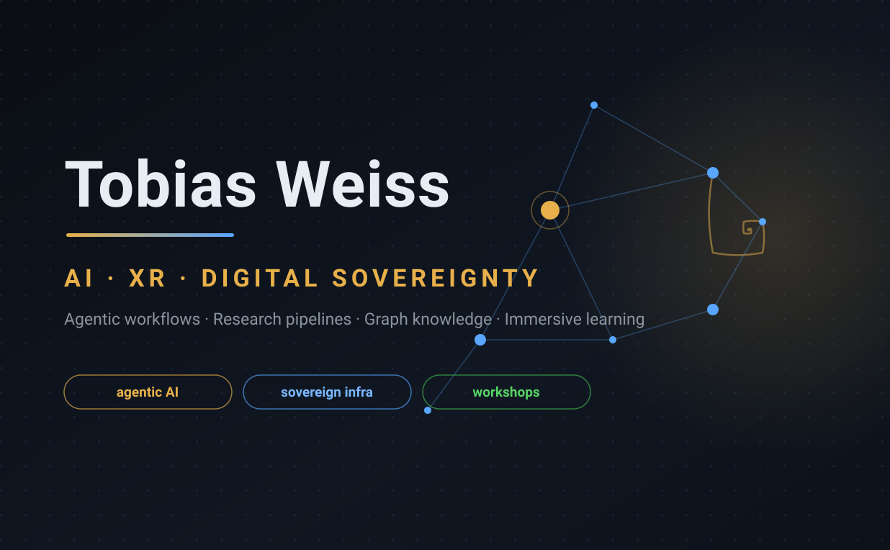

<p align="center">
  
</p>

<p align="center">
  <a href="https://tobias-weiss.org"></a>
  <a href="https://orcid.org/0009-0007-1417-8044"></a>
  <a href="https://mastodon.social/@graphwiz_ai"></a>
  <a href="https://www.linkedin.com/in/tobias-weiss-ai-xr/"></a>
</p>

---

### What I do

Building at the intersection of **AI**, **XR**, and **digital sovereignty** — agentic workflows, auto-validated research pipelines, graph-based knowledge systems, and self-hosted infrastructure.

- 🤖 **Agentic AI** — coding-agent workflows (`pi`), spec-driven automation, knowledge graphs ([graphwiz.ai](https://graphwiz.ai))
- 🎓 **Workshops & Trainings** — AI literacy, agentic AI, immersive learning
- 🛡 **Sovereign workplace** — self-hosted collaboration: SOGo, Stalwart, Kubernetes, openEduSuite/openSME-compose

---

### 🎓 Workshops & Trainings

| Workshop | Where |
|---------|-------|
| **Agentic AI in der Praxis — vom Spec zum produktiven Workflow** · 3h hands-on, streamed & recorded · [📖 materials](https://github.com/tobias-weiss-ai-xr/IT4Science-Days-2026-agentic-ai-workshop) | [IT4Science Days](https://plan.events.mpg.de/event/670/contributions/4047/), MPI-NAT Göttingen |
| **Agentic AI meets Sovereign Cloud** — openEduSuite on SCS-verified bare-metal · [📖 materials](https://github.com/tobias-weiss-ai-xr/sovereign-cloud-days-2026) | [Sovereign Cloud Days 2026](https://github.com/tobias-weiss-ai-xr/sovereign-cloud-days-2026) |
| **KI-Kompetenz-Training** — AI-literacy trainings & workshops for teams and organizations, evidence-based ([research](https://github.com/tobias-weiss-ai-xr/ai-literacy-research)) | [ki-kompetenz-training.org](https://ki-kompetenz-training.org) |
| **Immersive Chemistry Learning** — WebXR learning environment + research corpus | [chemie-lernen.org](https://chemie-lernen.org) |

---

### ⚡ pi — my daily-driver coding agent

<p align="center">
  
</p>

```bash
curl -fsSL https://pi.dev/install.sh | sh
```

I build my own extensions for it: [pi-saia-plugin](https://github.com/tobias-weiss-ai-xr/pi-saia-plugin) (GWDG SAIA models), plus Hessian and Zotero plugins.

---

### 🛠 Featured open source

| Project | Description |
|---------|-------------|
| [skeleton-research](https://github.com/tobias-weiss-ai-xr/skeleton-research) | Config-driven, auto-validated literature-review pipeline: `papers.yaml` → README/stats/reports + CI + Pages. Powers the [research repos](https://github.com/tobias-weiss-ai-xr?tab=repositories&q=*-research). |
| [docmakerai](https://github.com/tobias-weiss-ai-xr/docmakerai) | Auto-generates end-user software tutorials from Playwright screen recordings via LLM analysis → Docusaurus. |
| [riemann-research](https://github.com/tobias-weiss-ai-xr/riemann-research) | Riemann Hypothesis research corpus — Dgraph KB + prethought space + taskfleet. |
| [SOGo6-server](https://github.com/tobias-weiss-ai-xr/SOGo6-server) · [SOGo6-UI](https://github.com/tobias-weiss-ai-xr/SOGo6-UI) · [SOGo6-dockerized](https://github.com/tobias-weiss-ai-xr/SOGo6-dockerized) | Full sovereign groupware stack: Flask backend (CalDAV/CardDAV/IMAP), Next.js frontend, Stalwart + LDAP deployment. |
| [open-gov-automation](https://github.com/tobias-weiss-ai-xr/open-gov-automation) | Unix-philosophy automation for municipal government. Transparent. Automated. Sovereign. |
| [open-gpuworld](https://github.com/tobias-weiss-ai-xr/open-gpuworld) | What if the world had one GPU per person? |
| [PicoExperiments](https://github.com/tobias-weiss-ai-xr/PicoExperiments) | Unity/VR experiment skeleton for Pico 4 Enterprise — behavioral analytics in immersive decision-making. |

---

### 🏢 Sovereign business platforms

| Platform | Description |
|----------|-------------|
| [openEduSuite](https://openedu.graphwiz.ai/) | Open-source educational services on Kubernetes — ILIAS, Moodle, BigBlueButton |
| [openSME-compose](https://opensme.graphwiz.ai/) · [📦 repo](https://github.com/tobias-weiss-ai-xr/opensme-compose) | Docker Compose digital workplace for 5–500 users: Portal (Rust), Zitadel SSO, OpenCloud, Collabora, Stalwart, SOGo, Paperless |
| [Contextual Intelligence](https://contextual-intelligence.org) | Graph- and context-based lead generation |

### 🌱 Side projects

[MykoVolt](https://mykovolt.org/) — microbial fuel cells for decentralized energy · [World Office](https://codeberg.org/World-Office) — sovereign document editing from scratch

---

`TypeScript` · `Rust` · `Python` · `Three.js` · `WebXR` · `Kubernetes` · `Nix` · `PostgreSQL` · `Neo4j` · `Docker`

---

<p align="center">
  <a href="https://tobias-weiss.org">tobias-weiss.org</a> · <a href="https://graphwiz.ai">graphwiz.ai</a> · <a href="https://ki-kompetenz-training.org">ki-kompetenz-training.org</a>
</p>
